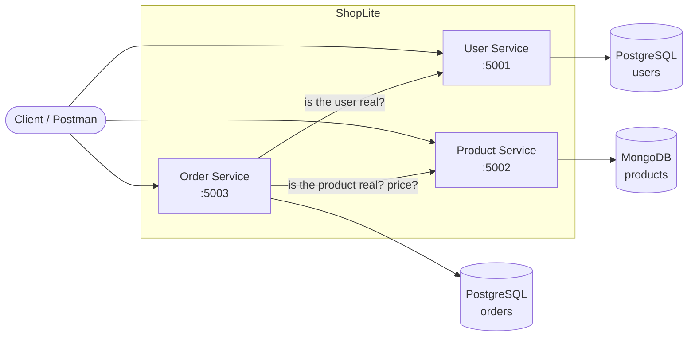
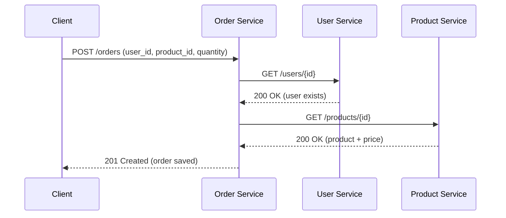

# 🛒 ShopLite – Microservices Project

ShopLite is a **small online shop** built with **microservices**.
It is our final project for the Automation course. We build it step by step: first the services, then Docker, then Kubernetes, then testing, CI/CD and monitoring.

---

## 👥 Team

| Member | Service | Main responsibility |
|---|---|---|
| **Maha Al-Tuhfi** | User Service | GitHub repo, Docker Compose, CI/CD pipeline (GitHub Actions), README |
| **Saheedat Abbas** | Product Service | Kubernetes files, scaling (HPA), security (RBAC, Network Policies), architecture diagram |
| **Victor Varon** | Order Service | Monitoring (Prometheus + Grafana), logging, integration and end-to-end tests |

---

## 🧩 What is a microservice? (simple explanation)

Imagine a shopping mall. Instead of **one huge store** that does everything, the mall has **small shops**, and each shop does one job:

- one shop handles **customers**,
- one shop handles **products**,
- one shop handles **orders**.

If one shop closes for repair, the others keep working. Each shop can grow on its own.

That is exactly what **microservices** are: a big application split into **small, independent programs**. Each one:

- does **one job**,
- has **its own database**,
- talks to the others over the network using a **REST API** (simple web requests like `GET` and `POST`).

---

## 🏗️ How ShopLite works

ShopLite has **3 services**, and each one has **its own database**:

| Service | What it does | Database | Port | Owner |
|---|---|---|---|---|
| **User Service** | Register users, log in, show a profile | PostgreSQL | `5001` | Maha |
| **Product Service** | Add, list, update and delete products | MongoDB | `5002` | Saheedat |
| **Order Service** | Place orders (asks the other two services first) | PostgreSQL | `5003` | Victor |

### Architecture diagram



### What happens when someone places an order



**How do services find each other?** They call each other **by name** (for example `http://user-service:5001`). Docker Compose and Kubernetes turn that name into the right address automatically. This is called **service discovery**.

---

## 🧱 Project parts

The project is built in 4 parts:

| Part | What we build | What it shows |
|---|---|---|
| **1. Microservices + Docker** | 3 services, each with its own database and REST API, each in a Docker container | Modular design, APIs, containers |
| **2. Kubernetes** | Run all services on a local cluster (Minikube), with auto-scaling and security rules | Deployment, scaling, service discovery |
| **3. Testing, CI/CD, Monitoring** | Automatic tests, a pipeline that tests and deploys on every push, dashboards and logs | Reliability, automation, observability |
| **4. Final presentation** | Live demo of the whole system | Architecture, deployment, lessons learned |

---

## 👤 User Service in detail

The User Service handles everything about users.

**What it can do:**

- **Register** a new user (name, email, password)
- **Log in** and get a token (a "digital ticket" that proves who you are)
- **Show a user's profile** by id
- **Health check** at `/health`, so Docker and Kubernetes know it is alive
- **Metrics** at `/metrics`, so Prometheus can watch it

**How it keeps data safe:**

- Passwords are **hashed** before saving, so nobody can read them
- The password is **never** sent back in any answer
- The same email **cannot** register twice

**Who uses it:** the Order Service calls `GET /users/{id}` to check that a user exists before saving an order.

---

## 🧰 Tools we use (and why)

| Tool | What it is (simple words) | Why we use it |
|---|---|---|
| **Python 3.12+** | A programming language | Easy to read and write |
| **Flask** | A small Python library for building web APIs | Lets us build REST endpoints in a few lines |
| **SQLAlchemy** | A Python library that talks to databases | We write Python instead of raw SQL |
| **PostgreSQL** | A database that stores data in tables | Stores users and orders |
| **MongoDB** | A database that stores data as documents (like JSON) | Stores products. Using two kinds of database is called **polyglot persistence**. |
| **pytest** | A testing tool for Python | Runs our automatic tests |
| **Postman** | An app to send requests to an API | Try our endpoints by clicking buttons |
| **Git + GitHub** | Git saves versions of our code; GitHub stores it online | Teamwork and history of changes |
| **VS Code** | A code editor | Write code and run commands |
| **Docker** | Packs an app and everything it needs into a **container** | "It works on my laptop" becomes "it works everywhere" |
| **Docker Compose** | Starts many containers with one command | Runs all services and databases together |
| **Kubernetes (Minikube)** | Runs and manages containers, restarts them if they crash, scales them | Required by the project; Minikube runs it on a laptop |
| **kubectl** | The command-line tool to control Kubernetes | Deploy and check our services |
| **Helm** | An "app store" for Kubernetes | Install Prometheus and Grafana easily |
| **GitHub Actions** | Runs tasks automatically when we push code | Our **CI/CD pipeline**: test → build → deploy |
| **Prometheus** | Collects numbers (metrics) from our services | Count requests, errors, CPU… |
| **Grafana** | Draws dashboards from those numbers | See the health of the system in charts |
| **Loki / Fluentd** | Collects logs from all services in one place | **Centralized logging** |

---

## 📁 Project folder structure

```
shoplite/
├── user-service/              ← Maha's microservice
│   ├── app.py                 ← the main code (API endpoints + database table)
│   ├── requirements.txt       ← list of Python libraries the service needs
│   ├── requirements-dev.txt   ← same list + pytest (only for testing)
│   ├── Dockerfile             ← recipe to build the Docker image
│   ├── .dockerignore          ← files Docker should NOT copy into the image
│   └── tests/
│       └── test_app.py        ← automatic tests (8 tests)
│
├── product-service/           ← Saheedat's microservice (coming soon)
├── order-service/             ← Victor's microservice (coming soon)
├── k8s/                       ← Kubernetes YAML files (coming in Week 10)
├── monitoring/                ← Prometheus/Grafana files (coming in Week 11)
├── .github/workflows/         ← CI/CD pipeline (coming in Week 11)
│
├── docker-compose.yml         ← starts all services + databases with one command
├── .env.example               ← example settings file (copy it to .env)
├── .gitignore                 ← files Git should never upload (like .env)
└── README.md                  ← this file
```

---

## 🔧 Step 1 – Install the tools

Install these once on your laptop. Keep the default options during setup.

| Tool | Download | Check it works (type in the terminal) |
|---|---|---|
| Git | https://git-scm.com | `git --version` |
| Python 3.12 or newer | https://www.python.org/downloads (tick **"Add Python to PATH"**) | `py --version` |
| VS Code | https://code.visualstudio.com | – |
| Docker Desktop | https://www.docker.com/products/docker-desktop | `docker --version` |
| Postman (optional) | https://www.postman.com/downloads | – |
| Minikube *(Week 10)* | https://minikube.sigs.k8s.io/docs/start | `minikube version` |
| kubectl *(Week 10)* | https://kubernetes.io/docs/tasks/tools | `kubectl version --client` |
| Helm *(Week 11)* | https://helm.sh/docs/intro/install | `helm version` |

---

## 📥 Step 2 – Get the code

```
git clone https://github.com/mahaaltuhfi/shoplite.git
cd shoplite
```

---

## ▶️ Step 3 – Run the User Service with Python

This is the quickest way to try the service. It uses a small local database file (SQLite), so you **don't need PostgreSQL or Docker** for this step.

Open the terminal in VS Code (**Terminal → New Terminal**) and run:

```
cd user-service
py -m pip install -r requirements-dev.txt
py app.py
```

> 💡 On Mac/Linux use `python3` instead of `py`.

You should see: `Running on http://127.0.0.1:5001`. **Leave this terminal open.**

Now open a **second terminal** (click the **+** in the terminal panel) and try it:

```
# Check the service is alive
Invoke-RestMethod http://localhost:5001/health

# Register a user
Invoke-RestMethod -Method Post -Uri http://localhost:5001/users -ContentType "application/json" -Body '{"name":"Maha","email":"maha@test.com","password":"123"}'

# Get user number 1
Invoke-RestMethod http://localhost:5001/users/1
```

To stop the service, go back to the first terminal and press **Ctrl + C**.

---

## ✅ Step 4 – Run the tests

Tests are small programs that **check our code works automatically**. They use a temporary in-memory database, so they never touch real data.

```
cd user-service
py -m pytest -v
```

Expected result: **8 passed**

| Test | What it checks |
|---|---|
| `test_health` | The `/health` endpoint answers "ok" |
| `test_register_user` | A new user can register, and the password is **never** returned |
| `test_register_missing_fields` | Registering without a name/email/password is rejected (400) |
| `test_register_duplicate_email` | The same email cannot register twice (409) |
| `test_login_success` | Correct email + password gives a token |
| `test_login_wrong_password` | Wrong password is rejected (401) |
| `test_get_user` | We can read a user's profile |
| `test_get_missing_user` | A user that doesn't exist gives 404 |

---

## 🐳 Step 5 – Run everything with Docker Compose

This runs the service **the real way**: inside a container, with a real **PostgreSQL** database.

1. **Start Docker Desktop** and wait until it says *"Engine running"*.
2. In the `shoplite` folder, create your settings file from the example: `copy .env.example .env` *(Mac/Linux: `cp .env.example .env`)*. Then open `.env` and change the passwords if you want.
3. Build and start everything: `docker compose up --build`
4. Test it the same way as in Step 3 (`http://localhost:5001/health`).
5. To stop: press **Ctrl + C**, then run `docker compose down`

### What happens behind the scenes

1. Docker reads `docker-compose.yml`.
2. It starts **`user-db`** (PostgreSQL) and waits until it is healthy.
3. It builds the **`user-service`** image using the `Dockerfile`.
4. It starts the service and connects it to the database by name (`user-db`).

### Why our Dockerfile follows best practices

| Practice | What it means |
|---|---|
| **Multistage build** | Stage 1 installs libraries, stage 2 copies only what's needed → smaller image |
| **Slim base image** (`python:3.12-slim`) | Small and fast to download |
| **Non-root user** (`appuser`) | If someone hacks the container, they don't get admin power |
| **Passwords in environment variables** | No passwords inside the code or the image |
| **`/health` endpoint** | Docker and Kubernetes can check if the service is alive |

Useful Docker commands:

```
docker compose ps                  # list running containers
docker compose logs user-service   # see the service's logs
docker compose down -v             # stop and also delete the database data
```

---

## 📡 API reference – User Service

Base URL: `http://localhost:5001`

| Method | Endpoint | What it does | Body (JSON) | Success | Errors |
|---|---|---|---|---|---|
| `GET` | `/health` | Is the service alive? | – | `200` | – |
| `POST` | `/users` | Register a new user | `{"name", "email", "password"}` | `201` | `400` missing data, `409` email exists |
| `POST` | `/login` | Log in | `{"email", "password"}` | `200` + token | `401` wrong email/password |
| `GET` | `/users/{id}` | Get one user's profile | – | `200` | `404` not found |
| `GET` | `/metrics` | Numbers for Prometheus | – | `200` | – |

### Examples

**Register** – `POST /users`

```json
{ "name": "Maha", "email": "maha@test.com", "password": "123" }
```

Response `201 Created`:

```json
{ "id": 1, "name": "Maha", "email": "maha@test.com", "created_at": "2026-11-12T17:01:51" }
```

**Login** – `POST /login`

```json
{ "email": "maha@test.com", "password": "123" }
```

Response `200 OK`:

```json
{ "token": "eyJhbGciOiJIUzI1NiIs...", "user_id": 1 }
```

> 🔒 Passwords are **hashed** (scrambled) before saving, so even we can't read them in the database.

### HTTP status codes (what the numbers mean)

| Code | Meaning |
|---|---|
| `200` | OK – it worked |
| `201` | Created – something new was saved |
| `400` | Bad request – you sent wrong or missing data |
| `401` | Unauthorized – wrong email or password |
| `404` | Not found – it doesn't exist |
| `409` | Conflict – it already exists |

---

## 🔐 Environment variables (settings & passwords)

We **never** write passwords in the code. They live in a file called `.env`, which Git ignores (it is listed in `.gitignore`), so it **never goes to GitHub**.

`.env.example` is a safe template with fake values. Each person copies it to `.env` on their own laptop.

| Variable | Used by | What it is |
|---|---|---|
| `USER_DB_USER` | user-db, user-service | Username for the users database |
| `USER_DB_PASSWORD` | user-db, user-service | Password for the users database |
| `JWT_SECRET` | user-service | Secret key used to create login tokens |
| `ORDER_DB_USER` | order-db, order-service | Username for the orders database |
| `ORDER_DB_PASSWORD` | order-db, order-service | Password for the orders database |
| `DATABASE_URL` | user-service | Full database address (built automatically in `docker-compose.yml`) |

---

## 🗺️ Project roadmap (Weeks 9–12)

### Week 9 – Part 1: Services + Docker
- [x] Create GitHub repository and folder structure *(Maha)*
- [x] User Service with register, login, profile *(Maha)*
- [x] 8 unit tests for User Service *(Maha)*
- [x] Dockerfile (multistage, non-root) *(Maha)*
- [x] Docker Compose with PostgreSQL *(Maha)*
- [ ] Product Service + MongoDB + Dockerfile *(Saheedat)*
- [ ] Order Service + PostgreSQL + Dockerfile *(Victor)*
- [ ] Architecture diagram *(Saheedat)*

### Week 10 – Part 2: Kubernetes
- [ ] Kubernetes YAML: Deployments, Services, ConfigMap, Secret *(Saheedat)*
- [ ] Horizontal Pod Autoscaler (HPA) for Product Service *(Saheedat)*
- [ ] RBAC + Network Policies *(Saheedat)*
- [ ] Everyone tests their service on Minikube *(All)*

### Week 11 – Part 3: Testing, CI/CD, Monitoring
- [ ] Unit tests for Product and Order services *(Saheedat, Victor)*
- [ ] Integration + end-to-end tests *(Victor)*
- [ ] GitHub Actions pipeline: test → build → deploy *(Maha)*
- [ ] Prometheus + Grafana dashboard *(Victor)*
- [ ] Centralized logging (Loki or Fluentd) *(Victor)*

### Week 12 – Part 4: Final presentation
- [ ] Rolling update + rollback demo *(Saheedat)*
- [ ] Final README and documentation *(Maha)*
- [ ] Presentation slides + demo video *(All)*

---

## 🧗 Challenges we faced (and how we fixed them)

We add to this list every week. It helps the team and our final presentation.

| Week | Who | Problem | How we fixed it |
|---|---|---|---|
| 9 | Maha | pytest said **"collected 0 items"** | The test file was created but empty. Pasted the code and saved it (Ctrl + S). |
| 9 | Maha | VS Code showed yellow **"Import could not be resolved"** warnings | VS Code was using a different Python. Not a real error; the code and tests still ran. |
| 9 | Maha | VS Code: **"Cannot launch terminal in an untrusted workspace"** | Opened the project folder and clicked **"Yes, I trust the authors"**. |
| 9 | Maha | README showed as one long paragraph on GitHub | Copied the preview instead of the raw text, so the heading and table symbols were lost. Pasted the raw Markdown. |

**Tip:** when something breaks, read the logs first: `docker compose logs user-service` (Docker) or `kubectl logs <pod-name>` (Kubernetes).

---

## 📖 Glossary (words explained)

| Word | Simple meaning |
|---|---|
| **API** | A way for programs to talk to each other |
| **REST API** | An API that uses web requests: `GET` (read), `POST` (create), `PUT` (update), `DELETE` (remove) |
| **Endpoint** | One address of the API, like `/users` |
| **JSON** | A simple text format for data: `{"name": "Maha"}` |
| **Container** | A box that holds an app and everything it needs to run |
| **Image** | The template used to create containers (built from a Dockerfile) |
| **Pod** | The smallest unit in Kubernetes – usually one container |
| **Deployment** | Tells Kubernetes how many copies of a pod to run |
| **Service (Kubernetes)** | A fixed name/address to reach pods |
| **HPA** | Horizontal Pod Autoscaler – adds more pods when traffic is high |
| **ConfigMap / Secret** | Settings / passwords stored in Kubernetes |
| **RBAC** | Rules for who is allowed to do what in Kubernetes |
| **CI/CD** | Continuous Integration / Continuous Deployment – automatically test, build and deploy on every push |
| **Hash** | A one-way scramble of a password, so it can't be read |
| **Token (JWT)** | A "digital ticket" a user gets after logging in |
| **Metrics** | Numbers about the app (requests, errors, CPU) |
| **Logs** | Text messages the app writes about what it is doing |

---

*Made by Maha, Saheedat and Victor.*